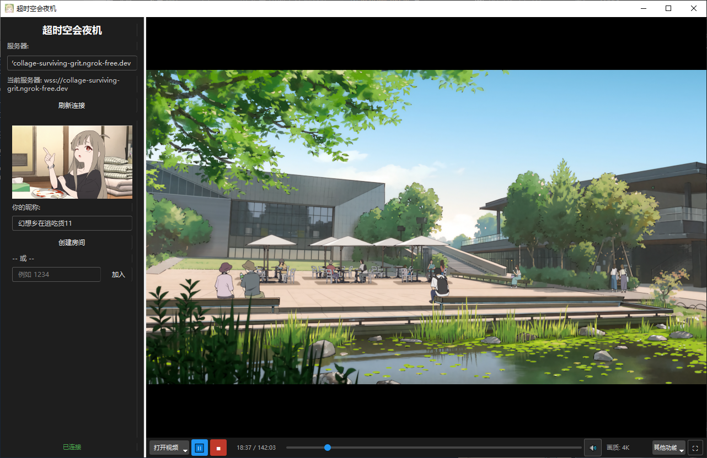
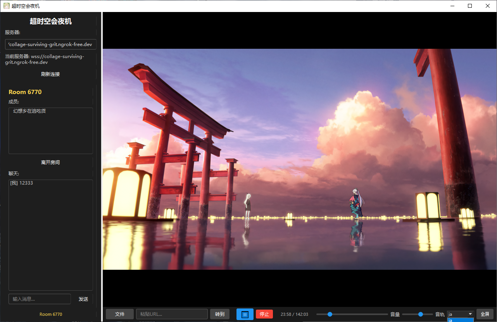

# 超时空会夜机

> 基于 WebSocket 的异地同步观影桌面应用


---

## 简介

超时空会夜机是一款支持**异地同步观影**的桌面应用。创建或加入房间后，播放进度实时同步。支持本地视频文件播放，也支持使用url播放，支持直接粘贴bilibili视频地址。

---

## 功能特性

| 功能 | 说明 |
|------|------|
| 房间同步 | 创建/加入房间，播放进度实时同步 |
| 断线恢复 | 自动重连，60秒内恢复原房间身份和最新播放状态 |
| 连接状态 | 显示往返延迟，异常断线自动清理在线成员 |
| 播放控制 | 播放、暂停、进度条跳转、音量调节、全屏 |
| B站视频 | 直接粘贴视频网页链接播放，支持分P切换、画质切换 |
| B站登录 | 在应用内显示二维码，使用 bilibili APP 扫码确认登录，获取账号可用的清晰度 |
| 音轨切换 | 多音轨视频可自由切换音频轨道 |
| 弹幕聊天 | 边看边聊|
| 快捷键 | 空格暂停/播放（同步）、左右方向键快进快退（同步） |
| 多客户端 | 不限人数 |
| 配置保存 | 自动记住上次的服务器地址、昵称和 bilibili 登录状态 |

---

## 快速开始

注：已上传服务端和客户端的打包文件，可直接下载使用。仅需**一人**配置服务端，其他人下载客户端即可。

### 环境要求

- Python 3.8+
- [ngrok](https://ngrok.com/) 或其他内网穿透工具（服务端需要）

### 安装依赖

```bash
pip install -r requirements.txt
```

### 启动服务端

```bash
python server.py
```

同时启动 ngrok 穿透本地端口：

```bash
ngrok http 9877
```

ngrok 会提供一个公网地址（例如 `https://xxx.ngrok-free.dev`），将https改为wss即为服务器地址，将地址发给朋友。

### 配置客户端

启动客户端后，在界面左上角输入服务器地址（如 `wss://xxx.ngrok-free.dev`）和昵称，点击"连接"即可。

点击 B站登录后，使用 bilibili APP 扫描应用内二维码并确认登录。登录状态与连接设置保存在本地 `config.json` 中；该文件由程序自动保存，不纳入 Git 版本管理。

### 启动客户端

```bash
python client.py
```

### 本地测试版：联机稳定性更新

当前源码包含待测试的 1.3.2 改动，客户端和服务端需要一起更新。已有的 1.3.1 EXE 和安装包不包含本次修改。

两人处于同一局域网或可互访的虚拟局域网时，由一人运行 `python server.py`。其他人在客户端填写 `ws://服务端的虚拟局域网IP:9877`，刷新连接后创建或加入房间；服务端电脑需允许 TCP 9877 入站。

- 短暂断网后自动重连并回房，离线会话保留60秒；主动离房不自动返回。服务端重启或会话过期后会提示重新创建或加入。
- 重连以服务端最新状态为准，不补发过期的播放、暂停和跳转指令。每2秒校准一次进度，小误差采用轻微调速，大误差或明确控制操作采用跳转。
- 聊天增加发送确认、补发和去重，最多保留32条待确认消息，60秒后停止补发并提示。回房时最多恢复最近100条聊天；这不是永久聊天记录。
- 各成员仍需自行打开相同视频。打开本地文件不会重置其他人的播放进度；更换影片后可用进度条统一跳转到开头。
- 本次增加的是连接恢复能力，不保证底层网络零丢包；自动发现房间和客户端内置服务端尚未加入。
- 点击“当前时间 / 视频时长”可输入秒数、`分:秒`、`时:分:秒`，回车跳转，Esc或失去焦点取消。非法时间、超出时长和未知时长会提示；房间内沿用同步跳转，暂停状态保持不变。
- 修正Windows文件选择框与mpv的斜杠差异，避免本地视频已播放却一直提示“等待加载”。左右方向键每次点按跳转5秒，长按产生的系统重复事件忽略；房间内由服务端统一计算并同步给在线成员，片头/片尾限制在视频范围内。聊天和时间编辑框中的方向键保持文本编辑用途。
- 点击喇叭切换静音，再次点击恢复最后一次非零音量；悬停调音浮窗不再拦截喇叭点击。加载视频前设置的音量也会保留。
- 扫码登录的生成、轮询、账号验证全部在后台执行，优先复用确认响应中的凭据，减少跨站请求。失败重试、二维码过期重新生成和取消都不会阻塞窗口。
- B站按清晰度ID选择真实视频流，修复WBI签名及切流音轨加载。下拉菜单只显示当前账号实际获得的视频流；切换保持进度和播放状态，解析在后台进行。登录后请重新打开视频刷新可用画质，清晰度仍受账号和视频权限限制。
- 2026-10-13 使用 `BV1mfay6pEti` 完成 4K→1080P→720P→360P 实际解码验证；未登录接口返回480P和360P。此结果仅代表该视频、当前账号及当次接口响应。

完整审查范围、测试结果和后续优化优先级见 [审查与测试报告.txt](审查与测试报告.txt)。

建议手动验证：两人连接并播放同一视频，短暂断网后恢复，检查身份是否重复、播放进度是否恢复、聊天是否重复；再测试主动离房、服务端重启和不同清晰度播放。

开发检查（在项目根目录执行）：

```bash
python -m unittest discover -s tests -v
python tests/gui_smoke.py
python tests/media_smoke.py
python tests/login_smoke.py
# 可选：联网验证指定B站视频，仅从个人配置读取登录状态
python tests/media_smoke.py --live-bilibili
```

界面检查使用临时配置、隐藏的 Qt 窗口和 mpv 空输出，验证真实客户端联机与媒体切换流程，不修改个人登录配置。联网媒体测试需要当前账号具备该视频4K权限；没有权限时会明确失败，不绕过平台限制。

## 项目结构

```
film-app/
├── server.py               # WebSocket 服务端：房间管理、播放同步广播
├── client.py               # 客户端入口
├── requirements.txt        # Python 依赖
├── build_client_1.3.1.spec  # 1.3.1 客户端 PyInstaller 打包配置
├── 更新日志.txt             # 版本更新记录
│
├── app/                    # 客户端核心模块
│   ├── player.py           # mpv 视频播放器封装及音视频切流
│   ├── bilibili.py         # B站 WBI 签名、请求与实际清晰度选择
│   ├── bili_login.py       # 可取消的扫码登录后台会话
│   ├── timecode.py         # 时间输入解析与格式化
│   ├── network.py          # WebSocket 网络通信层（异步收发、自动重连）
│   ├── sync.py             # 播放进度校准策略
│   ├── runtime.py          # Qt 插件及 DLL 路径初始化
│   ├── config.py           # JSON 配置持久化管理
│   │
│   └── ui/                 # PySide6 界面组件
│       ├── main_window.py  # 主窗口、布局、同步逻辑调度、B站登录
│       ├── controls.py     # 播放控制栏（进度条、音量、画质、音轨、分P）
│       ├── bili_login_dialog.py # 非阻塞扫码登录界面
│       ├── room_panel.py   # 房间面板（创建/加入、成员列表、昵称图片）
│       └── danmaku.py      # 弹幕浮层组件
│
├── libmpv/                 # libmpv-2.dll 运行时库
├── mpv_config/             # mpv 播放器配置（字体、input.conf）
├── assets/                 # 图标、图片等资源文件
└── screenshots/            # 界面截图
```

---

## 界面预览

### 首页


### 加入房间


---

## 技术栈

| 技术 | 用途 |
|------|------|
| Python + asyncio | 异步服务端与客户端通信 |
| websockets | WebSocket 实时双向通信 |
| mpv + python-mpv | 高性能视频播放（GPU 硬解） |
| PySide6 (Qt6) | 跨平台桌面 UI 框架 |
| yt-dlp | B站视频链接解析与流媒体提取 |
| segno | 生成 B站登录二维码 |
| ngrok | 内网穿透，公网访问 |
| B站 API (WBI) | 在线视频清晰度列表与播放地址获取 |

---

## 第三方依赖

| 包 | 版本 | 说明 |
|------|------|------|
| PySide6 | >=6.0 | Qt6 界面框架 |
| python-mpv | >=1.0 | mpv Python 绑定 |
| websockets | >=13.1 | 异步 WebSocket |
| yt-dlp | 最新 | 视频链接解析 |
| segno | — | 登录二维码生成 |

---

## 作者

[@hxxztch](https://github.com/hxxztch)
