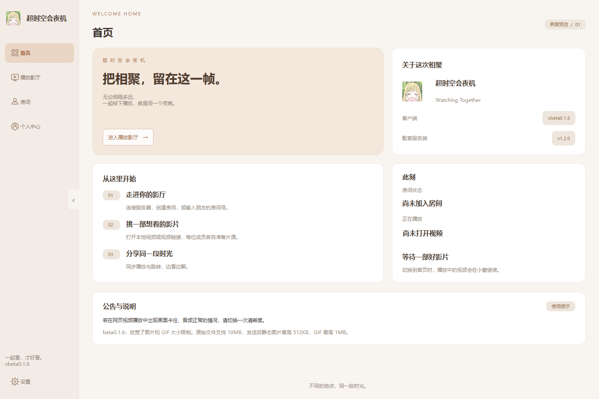
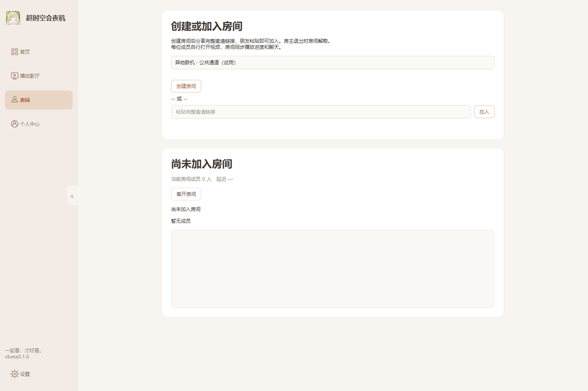
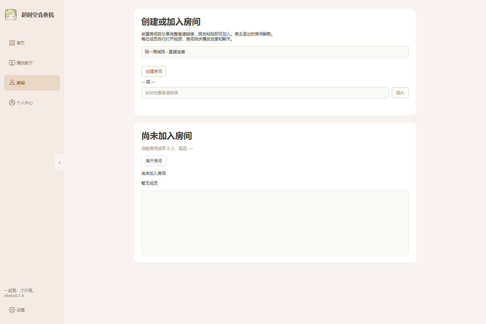
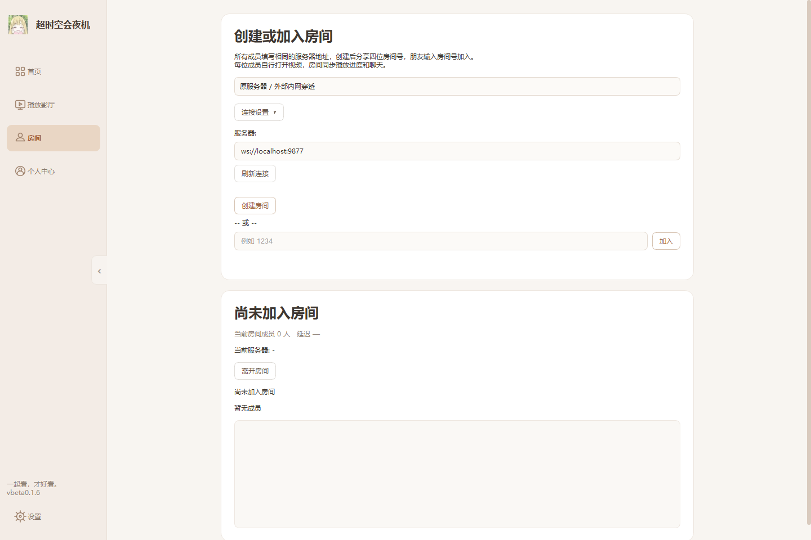
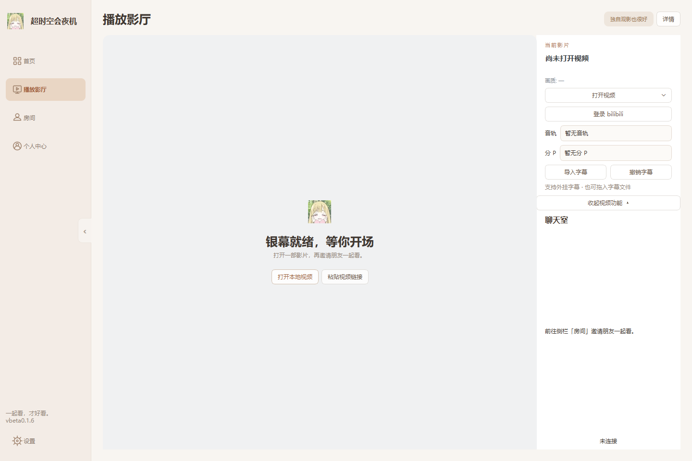
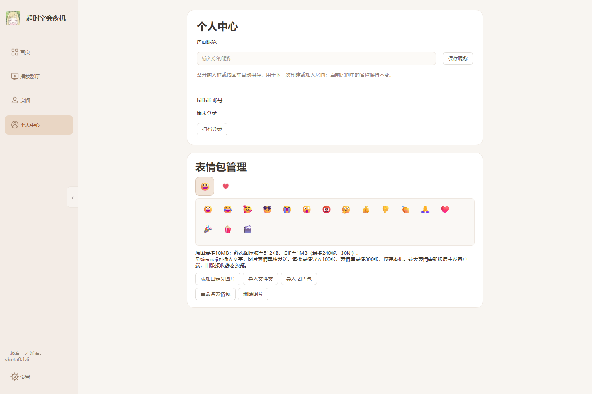
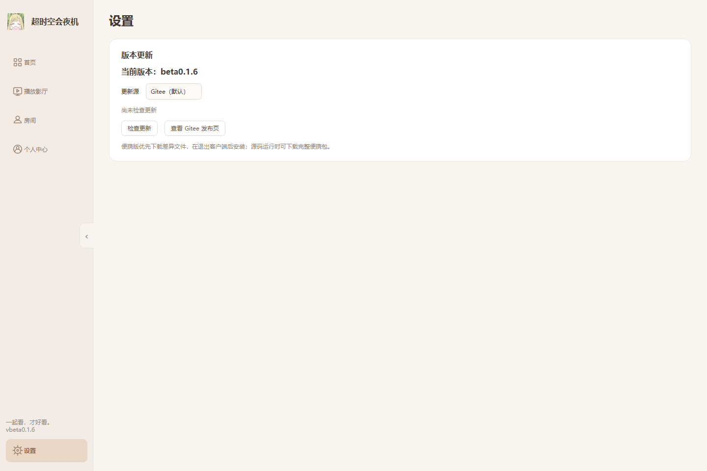

# 超时空会夜机

> 基于 WebSocket 的异地同步观影桌面应用

当前版本为 **beta0.1.6**，配套服务端版本为 **1.2.0**。客户端提供首页、播放影厅、房间、个人中心和设置，支持同步观影、文字与图片聊天、GIF 动态表情、外挂字幕和版本更新。

在「房间」中选择异地公共通道、同一局域网或原服务器连接方式。内置房间通过完整邀请链接加入，房主退出时房间解散。每位成员自行打开影片，房间同步播放状态和进度，不传输视频文件。


---

## 简介

超时空会夜机是一款支持**异地同步观影**的桌面应用。支持打开本地视频、视频直链和 bilibili 视频链接，在房间中同步播放、暂停与进度跳转，并通过聊天室和弹幕交流。也可以不加入房间，独自播放视频。

---

## 功能特性

| 功能 | 说明 |
|------|------|
| P2P 房主推流（局域网） | 房主打开本地视频，成员自动接收音视频；支持暂停、恢复、跳转和停止 |
| 房间同步 | 创建或加入房间，同步播放、暂停和进度跳转 |
| 三种连接方式 | 异地公共通道、局域网直接连接、原服务器 / 外部内网穿透 |
| 邀请与成员 | 一键复制房间分享信息，客户端前台识别邀请并确认加入；查看成员和连接延迟 |
| 断线恢复 | 短暂断线后自动重连，恢复有效会话及服务端播放状态 |
| 播放控制 | 进度条、时间输入、音量、静音、音轨切换和全屏 |
| B站视频 | 支持视频链接、分P和画质切换；可用画质取决于视频及账号权限 |
| B站登录 | 使用 bilibili APP 扫码登录，在个人中心查看登录状态或退出登录 |
| 外挂字幕 | 导入或拖入字幕文件，撤销手动添加的字幕 |
| 小窗播放 | 播放时切回首页或最小化主窗口，以小窗继续观看 |
| 聊天与弹幕 | 文字、系统 emoji、图片及 GIF 动态表情；可单独开关本机弹幕显示 |
| 表情包管理 | 添加图片、导入文件夹或 ZIP、重命名与删除，收藏聊天图片 |
| 图片与 GIF | 原文件最大 10 MB；发送静态图片最高 512 KB，GIF 最高 1 MB |
| 快捷键 | 空格播放 / 暂停，左右方向键每次跳转 5 秒 |
| 配置保存 | 保存昵称、服务器地址、bilibili 登录状态及更新源选择 |
| 客户端更新 | Gitee / GitHub 更新源，便携版支持差异更新 |

---

## 快速开始

从 [Gitee 发布页](https://gitee.com/hxxztch/watching-together/releases)或 [GitHub 发布页](https://github.com/hxxztch/WatchingTogether/releases)获取 Windows x64 客户端便携包。完整解压后运行其中的客户端 EXE，保留同目录的 `_internal` 文件夹。完整包的顶层文件夹为「超时空会夜机」。

使用内置房间时，只需客户端。使用独立服务端方式时，由一人运行服务端，其他成员连接该服务端。

### 环境要求

- 便携版：Windows x64，解压完整客户端包后运行。
- 源码运行：Python 3.8+，安装下列依赖，并准备与 Python 架构匹配的 `libmpv/libmpv-2.dll`。依赖版本需支持所用 Python 版本。
- 异地公共通道：使用 Cloudflare Quick Tunnel；源码运行需准备 `tools/cloudflared.exe`，可执行 `powershell -ExecutionPolicy Bypass -File packaging/fetch_cloudflared.ps1` 下载。
- 局域网或外部服务器：成员之间需能访问房主或服务端的网络地址。

### 安装依赖

在项目目录创建独立 Python 环境并安装依赖：

```bat
py -3 -m venv .venv
.venv\Scripts\python.exe -m pip install -r requirements.txt
```

从 Gitee 克隆源码时，可设置 `GIT_LFS_SKIP_SMUDGE=1` 跳过 LFS 下载，再从完整便携包的 `_internal/libmpv/libmpv-2.dll` 复制实际 DLL 到源码的 `libmpv/libmpv-2.dll`。LFS 指针文件不能作为运行库使用。

P2P 局域网推流的源码运行需使用 Python 3.11 或更高版本，安装可选依赖：

```bat
python -m pip install -r requirements-p2p.txt
```

创建房间时选择「同一局域网 · 直接连接」，将观影模式设为「房主推流 · P2P」。房主创建房间并分享完整邀请链接，成员加入后无需打开片源；房主在播放影厅打开本地视频即可发送。成员可独立调整音量、全屏和小窗，播放进度由房主控制。「重试媒体直连」用于重新建立媒体连接。

当前 P2P 入口为源码中的局域网阶段实现，使用独立的 WebRTC 音视频连接；网页片源、异地 STUN 穿透和便携包集成尚未接入。普通同步观影仍沿用原安装与运行方式。

### 客户端更新与自动发布

「设置 → 更新源」默认选择 **Gitee**，可切换为 **GitHub**。便携版启动后检查同一 beta 通道的新版本，也可在设置页手动检查、下载更新和查看发布页。

便携版优先使用适用的差异包，点击「安装更新并重启」后安装；个人 `config.json` 和 `stickers` 表情库保留。源码运行时提供完整便携包下载。若旧版更新器安装失败，可关闭旧客户端，将完整包解压到新目录，再迁移 `config.json` 和 `stickers`。

Gitee 的分段附件在软件内下载时自动合并、校验。手动下载时需取得全部分段和发行页提供的 `merge-betaX.Y.Z.cmd`，运行合并脚本后解压完整 ZIP。

项目在统一的 `beta` 分支开发。发布时修改 `app/version.py` 中的版本，并更新 `更新日志.txt` 首节，推送 `beta` 后由 [GitHub Actions](.github/workflows/release-beta.yml)构建完整包和差异包、创建对应版本标签，以正式 Release（Latest）发布，并同步 Gitee 源码、附件及两端更新清单。已发布的版本不会因普通提交而重复打包；每个小版本使用标签记录，不再单独建立长期分支。Gitee 自动同步使用仓库的 `GITEE_TOKEN` Actions Secret。

### 启动服务端

内置房间由客户端启动房主服务。需要独立部署时，在已安装依赖的环境运行：

```bat
.venv\Scripts\python.exe server.py
```

默认端口为 `9877`。同机连接 `ws://127.0.0.1:9877`，局域网成员填写 `ws://服务端IP:9877`。服务端防火墙需允许相应端口入站。

通过外部内网穿透服务访问时，将其提供的 WebSocket 地址填入客户端。例如使用 ngrok：

```bash
ngrok http 9877
```

将得到的 HTTPS 地址以 `wss://` 协议填写到客户端的服务器地址中。

### 配置客户端

先在「个人中心」填写房间昵称，再进入「房间」选择连接方式：

- **异地联机 · 公共通道（试用）**：创建房间后复制完整邀请链接，朋友粘贴链接加入。公共通道依赖 Cloudflare Quick Tunnel 服务及网络可达性。
- **同一局域网 · 直接连接**：由房主创建房间，选择可供成员访问的局域网地址，再分享完整邀请链接。
- **原服务器 / 外部内网穿透**：填写服务器地址，连接后创建房间或通过房间号加入。

内置房间生成邀请链接后，点击「分享房间」复制完整分享信息，也可选择「仅复制链接」。朋友复制后打开或切回客户端，会出现加入确认框；也可将整段信息粘贴到房间输入框识别。确认框支持填写昵称，切换房间前明确提示离开或解散当前房间。暂不加入的同一邀请在本次运行中不再自动提示，但仍可手动粘贴。

进入「播放影厅」打开本地视频或粘贴视频链接，各成员分别准备同一影片。在个人中心或影厅点击 bilibili 登录按钮，使用 bilibili APP 扫码确认。

个人设置保存在程序目录的 `config.json`，自定义表情保存在 `stickers` 文件夹。

### 启动客户端

Windows 下可双击「启动界面预览.cmd」，使用 PATH 中的系统 `python` 启动。请先安装 Python 3.8 或更高版本并执行 `python -m pip install -r requirements.txt`；未找到 Python、缺少依赖或运行库加载失败时，脚本会提示手动配置。也可在前文创建的虚拟环境中直接运行：

```bat
.venv\Scripts\python.exe client.py
```

### 稳定版客户端1.3.2 / 服务端1.2.0（原连接模式参考）

历史稳定版位于 [master](https://github.com/hxxztch/WatchingTogether/tree/master)。稳定版使用独立服务端连接方式；当前 beta 客户端同时提供内置房间和原服务器入口。

独立服务端模式下，由一人运行服务端，其余成员填写服务端地址，再创建或加入房间。便携程序需保留 EXE 旁的 `_internal` 目录；源码压缩包需安装 Python 依赖和运行库后运行。

版本变更见[更新日志.txt](更新日志.txt)。

### 联机稳定性与播放更新

- 短暂断线后自动重连，服务端保留离线会话 60 秒；主动离房不自动返回。恢复时以服务端最新播放状态为准。
- 播放进度定期校准；聊天消息包含发送确认、补发和去重，回房时恢复服务端保留的近期消息。
- 内置房间由房主客户端承载，房主退出后房间解散。每位成员自行打开同一影片，房间不分发视频文件。
- 点击「当前时间 / 视频时长」可输入秒数、`分:秒` 或 `时:分:秒`，回车跳转；房间内同步进度操作。
- 音量、静音、音轨、画质及外挂字幕由各客户端本地设置。B站画质选项以当前账号可获得的视频流为准。
- 表情包支持 PNG、JPG、WebP、BMP 和 GIF。静态图发送最长边为 1024 像素，GIF 最长边为 320 像素、最多 240 帧和 30 秒；导入与发送还受解码量限制。
- 聊天图片可通过右键「添加到表情」收藏。较大图片和 GIF 需要新版房主 / 服务端及接收客户端，旧版接收静态预览。
- 网页视频若出现画面卡住而音频正常，可切换一次清晰度。

## 项目结构

```text
watching-together/
├── server.py               # WebSocket 服务端
├── client.py               # 客户端入口
├── requirements.txt        # 源码运行依赖
├── 启动界面预览.cmd         # Windows 源码启动器
├── 更新日志.txt             # 版本记录
├── .github/workflows/      # 自动构建与发布工作流
├── app/                    # 客户端核心模块
│   ├── version.py          # 客户端与服务端版本
│   ├── player.py           # mpv 播放器封装
│   ├── bilibili.py         # B站视频解析与画质选择
│   ├── bili_login.py       # 扫码登录
│   ├── network.py          # WebSocket 通信与重连
│   ├── sync.py             # 播放进度校准
│   ├── hosting.py          # 内置房主服务与邀请链接
│   ├── room_controller.py  # 房间生命周期管理
│   ├── tunnel.py           # Cloudflare 公共通道
│   ├── chat_media.py       # 图片与 GIF 消息处理
│   ├── updates.py          # 更新源与版本清单
│   ├── runtime.py          # Qt 插件与 DLL 路径
│   ├── config.py           # 个人配置保存
│   └── ui/                 # PySide6 界面组件
│       ├── main_window.py  # 主窗口与功能调度
│       ├── shell.py        # 首页、导航与小窗
│       ├── controls.py     # 播放控制
│       ├── room_panel.py   # 房间、成员与聊天
│       ├── profile.py      # 昵称与登录状态
│       ├── sticker_library.py # 表情包管理
│       ├── settings.py     # 更新设置
│       └── danmaku.py      # 弹幕浮层
├── packaging/              # 构建、发布与更新脚本
├── tests/                  # 开发检查脚本
├── libmpv/                 # libmpv-2.dll 运行库
├── mpv_config/             # mpv 配置
├── assets/                 # 图标与资源
├── preview/                # 界面预览资源
└── screenshots/            # README 界面截图
```

---

## 界面预览

以下为 beta0.1.6 客户端界面。

### 首页

版本信息、使用引导、房间与播放状态，以及公告说明。



### 加入房间

异地公共通道、局域网和原服务器三种连接入口。







### 播放影厅

视频播放区域、影片信息、音轨与分P、外挂字幕，以及聊天室。



### 个人中心

房间昵称、bilibili 登录状态与表情包管理。



### 设置

查看当前版本、选择更新源和检查更新。



---

## 技术栈

| 技术 | 用途 |
|------|------|
| Python + asyncio | 异步服务端与客户端通信 |
| websockets | WebSocket 双向通信 |
| mpv + python-mpv | 视频播放、音轨与字幕控制 |
| PySide6 (Qt6) | 桌面界面 |
| yt-dlp | 视频链接解析与媒体提取 |
| segno | B站登录二维码 |
| Pillow | 图片与 GIF 处理 |
| Cloudflare Quick Tunnel | 内置异地房间的公共通道 |
| B站 API (WBI) | B站视频信息、画质与播放地址 |

---

## 第三方依赖

| 包 | 版本 | 说明 |
|------|------|------|
| PySide6 | >=6.0 | Qt6 界面框架 |
| python-mpv | >=1.0 | mpv Python 绑定 |
| websockets | >=13.1 | 异步 WebSocket |
| yt-dlp | 未固定 | 视频链接解析 |
| segno | 未固定 | 登录二维码生成 |
| Pillow | >=10.4,<11 | 图片与 GIF 处理 |

源码依赖见 [requirements.txt](requirements.txt)，构建依赖见 [packaging/requirements-lock.txt](packaging/requirements-lock.txt)。mpv 运行库另行准备，公共通道组件说明见 [THIRD-PARTY-CLOUDFLARED.txt](THIRD-PARTY-CLOUDFLARED.txt)。

---

## 作者

[@hxxztch](https://github.com/hxxztch)
